<p align="center">
  
</p>


<h1 align="center">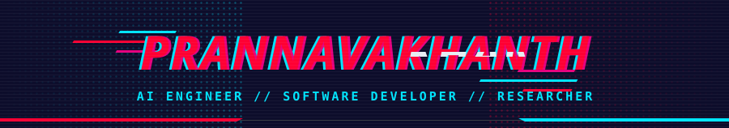</h1>

<p align="center"><i>"Building intelligent systems. Exploring the boundaries of AI."</i></p>

<p align="center"><a href="https://github.com/prnvvv"></a> <a href="https://linkedin.com/in/prannavakhanth"></a> <a href="https://leetcode.com/u/peter-parker"></a> <a href="https://prnvvv-portfolio-website.vercel.app"></a> <a href="mailto:prannavakhanth12@gmail.com"></a></p>

<h2>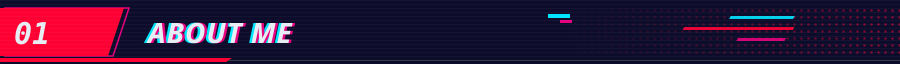</h2>


<table>
<tr><td width="170" valign="top"><code>EDUCATION</code></td><td width="830" valign="top"><b>B.Tech CSE</b> · VIT Chennai</td></tr>
<tr><td valign="top"><code>CGPA</code></td><td width="830" valign="top"><b>9.08 / 10</b></td></tr>
<tr><td valign="top"><code>LOCATION</code></td><td width="830" valign="top">Chennai, India</td></tr>
<tr><td valign="top"><code>SPECIALIZATION</code></td><td width="830" valign="top">AI/ML &amp; Intelligent Systems</td></tr>
<tr><td valign="top"><code>STATUS</code></td><td width="830" valign="top"><b>BUILDING // RESEARCHING // ENGINEERING</b></td></tr>
</table>

<ul>
<li>Computer Science and Engineering undergraduate at VIT Chennai: AI Engineer, Software Developer and Researcher.</li>
<li>Experience across enterprise software engineering, AI/ML and research.</li>
<li>Interested in Agentic AI, Generative AI, RAG, intelligent automation and production-oriented systems.</li>
<li>Open-source contributor and technical community leader.</li>
<li>Passionate about building practical AI systems that solve real-world problems.</li>
</ul>

<h2>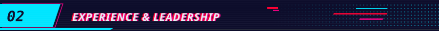</h2>


<table>
<tr>
<td width="1000" valign="top">
<br>
<b>Associate Software Developer, Data Science</b> · CBRE<br>
Building data-driven solutions with engineering teams and applying technology to real business problems.
</td>
</tr>
<tr>
<td width="1000" valign="top">
<br>
<b>Software Development Engineer Intern</b> · Hexaware Technologies<br>
<sub><code>Chennai, India · 2026</code></sub>
<p>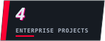 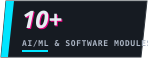  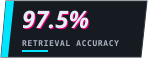 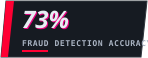</p>
<ul>
<li>Developed 4 enterprise-level projects with 10+ AI/ML and software modules.</li>
<li>Drove product decisions through data analysis across 1,000+ hospital datasets for a US hospital CMS price-transparency solution.</li>
<li>Built <b>Polaris</b>, an agentic RAG chatbot for internal company documents and policies, achieving 97.5% retrieval accuracy.</li>
<li>Developed HTML-embedded email and Google Sheets automation.</li>
<li>Built a proxy-driven HNI module for insurance claim fraud detection, using anomaly confidence scoring to flag potentially fraudulent claims with 73% detection accuracy.</li>
<li>Developed automation tools for customer-facing products.</li>
<li>Worked across full-stack development, AI/ML, REST APIs, testing and deployment.</li>
</ul>
</td>
</tr>
<tr>
<td width="1000" valign="top">
<br>
<b>Research Intern</b> · AnnamAI, AI Centre of Excellence, IIT Ropar<br>
<ul>
<li>Developed <b>AgroNome</b>, an AI-powered agricultural research platform centered on digital twins of plants.</li>
<li>Used genetic and plant data to simulate responses to artificial environmental conditions.</li>
<li>Integrated 8+ AI/ML modules for crop disease and weed detection, yield prediction, irrigation optimization, crop recommendation, crop rotation and AI-driven reasoning.</li>
<li>Individual models achieved 90%+ accuracy.</li>
<li>Combined simulated and real-time agricultural data to support crop monitoring and decision-making.</li>
</ul>
</td>
</tr>
</table>


<table>
<tr>
<td width="1000" valign="top">
&nbsp; <b>President</b> · Open Source Programming Club, VIT Chennai<br>
Led a technical community of 250+ members and led the club to win the Best Club Award.
</td>
</tr>
<tr>
<td width="1000" valign="top">
&nbsp; <b>Data Science Lead</b> · IEEE Robotics &amp; Automation Society, VIT Chennai
</td>
</tr>
<tr>
<td width="1000" valign="top">
&nbsp; <b>Student Council Member</b> · VIT Chennai
</td>
</tr>
</table>

<h2>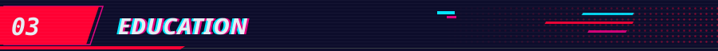</h2>

<table>
<tr>
<td width="1000" valign="top">
<br>
<b>Vellore Institute of Technology, Chennai</b><br>
Bachelor of Technology · Computer Science and Engineering<br>

</td>
</tr>
<tr>
<td width="1000" valign="top">
<br>
<b>P. S. Senior Secondary School</b><br>
Higher Secondary Education, Class XII · <sub><code>Graduated May 2023</code></sub><br>

</td>
</tr>
</table>

<h2>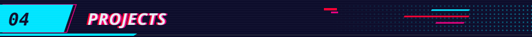</h2>


<table>
<tr>
<td width="80" valign="top" align="center"></td>
<td valign="top">
<br>
<b>POLARIS · Agentic RAG Platform</b><br>
<sub><code>AGENTIC RAG · LANGGRAPH · ENTERPRISE KNOWLEDGE</code></sub><br>
<br>
<p>Engineered an agentic RAG platform for internal company documents and policies.</p>
<sub><b>KEY CAPABILITIES</b></sub><br>
LangGraph-based orchestration · Groq-powered LLM integration · ChromaDB vector storage · Multi-query rewriting · Semantic chunking · MMR-based retrieval · Hybrid BM25 + dense retrieval · Multimodal PDF, DOCX, URL and image ingestion · Reasoning-driven routing · Structured citation generation · Conversational memory · Intelligent tool orchestration<br><br>
       
</td>
</tr>
<tr>
<td width="80" valign="top" align="center"></td>
<td valign="top">
<br>
<b><a href="https://github.com/DerrickUnleashed/Kred">KRED</a> · AI-Powered Financial Intelligence Platform</b><br>
<sub><code>FINTECH · AI · GEN Z FINANCIAL RISK AWARENESS</code></sub><br>
<br>
<p>Designed an AI-powered financial platform focused on financial risk awareness for Gen Z.</p>
<sub><b>KEY CAPABILITIES</b></sub><br>
Personal financial data analysis · Future life-scenario visualization · Budget tracking · Expense analysis · Portfolio monitoring · LSTM-based stock prediction · LLM-based financial reasoning · Retirement planning · Personalized recommendations · Financial scenario generation<br><br>
      <br><br>
<a href="https://github.com/DerrickUnleashed/Kred"></a>
</td>
</tr>
<tr>
<td width="80" valign="top" align="center"></td>
<td valign="top">
<br>
<b><a href="https://github.com/mithilgirish/Crop-Core_Tech">AGRONOME</a> · AI-Powered Smart Agriculture Platform</b><br>
<sub><code>AGRITECH · DIGITAL TWINS · COMPUTER VISION</code></sub><br>
<br>
<p>Developed an AI-powered agricultural research platform centered on digital twins of plants. Integrated 8+ AI/ML modules, with individual models achieving 90%+ accuracy.</p>
<sub><b>KEY CAPABILITIES</b></sub><br>
Genetic and plant-data-driven simulations · Artificial environmental condition modeling · Crop disease detection · Weed detection · Yield prediction · Market analysis · Irrigation optimization · Crop recommendation · Crop rotation · AI-driven reasoning · Real-time agricultural data integration<br><br>
   <br><br>
<a href="https://github.com/mithilgirish/Crop-Core_Tech"></a>
</td>
</tr>
</table>


<table>
<tr>
<td width="1000" valign="top">
<b>AutCore</b><br>
AI-driven autism screening system · 2 computer vision modules · speech analysis · behavioral assessment · 65% overall screening accuracy.
</td>
</tr>
<tr>
<td width="1000" valign="top">
<b>LLM-based SRE Agent</b><br>
LLM-powered agent for incident analysis and troubleshooting.
</td>
</tr>
<tr>
<td width="1000" valign="top">
<b>NIDs</b><br>
Cloud-based network intrusion detection system.<br>
<a href="https://github.com/prnvvv/AI-Powered-Intrusion-Detection-System-for-Real-Time-Cloud-Security"></a>
</td>
</tr>
<tr>
<td width="1000" valign="top">
<b>Medical Image Analysis &amp; Encryption</b><br>
2.5D CNN-based medical image analysis with AES encryption.
</td>
</tr>
<tr>
<td width="1000" valign="top">
<b>Diabetes Screening System</b><br>
Three-module diabetes risk assessment system.
</td>
</tr>
<tr>
<td width="1000" valign="top">
<b>AI Career Platform</b><br>
AI-powered career platform with mock interviews and ATS features.
</td>
</tr>
<tr>
<td width="1000" valign="top">
<b><a href="https://github.com/prnvvv/pkstruct">pkstruct</a></b><br>
Published Python DSA library with built-in visualization. Production-grade Python package for optimised data structures, algorithms, visualization and systems utilities. Built for scalability, education, competitive programming and production use.<br>
 <br>
<a href="https://github.com/prnvvv/pkstruct"></a> <a href="https://pypi.org/project/pkstruct/"></a>
</td>
</tr>
</table>


<table>
<tr>
<td width="1000" valign="top">
<b><a href="https://github.com/prnvvv/Synthetic-Taphonomic-Deformation-Generation-for-Paleontological-Deep-Learning">Synthetic Taphonomic Deformation Generation for Paleontological Deep Learning</a></b><br>
Open-source synthetic fossil-deformation pipeline generating 14,000 labelled images from 3D archosaur scans across 4 taphonomic deformation types and 10 intensity levels, enabling paleontological deep learning research.<br>
 <br>
<a href="https://github.com/prnvvv/Synthetic-Taphonomic-Deformation-Generation-for-Paleontological-Deep-Learning"></a>
</td>
</tr>
<tr>
<td width="1000" valign="top">
<b><a href="https://github.com/DerrickUnleashed/Mango">Mango</a></b><br>
Visibility-aware, self-supervised identity learning for long-term fruit tracking and counting in mango orchards. Recovers fruit identities after occlusion so counts stay correct over long video runs.<br>
   <br>
<a href="https://github.com/DerrickUnleashed/Mango"></a> <a href="https://orchardvision.vercel.app"></a>
</td>
</tr>
<tr>
<td width="1000" valign="top">
<b><a href="https://github.com/prnvvv/RL-Studio">RL-Studio</a></b><br>
Meta AI-powered reinforcement learning platform for intelligent training, verification, diagnosis and self-healing.<br>
       <br>
<a href="https://github.com/prnvvv/RL-Studio"></a> <a href="https://meta-rl-studio.vercel.app/"></a>
</td>
</tr>
<tr>
<td width="1000" valign="top">
<b><a href="https://github.com/prnvvv/FitAI">FitAI</a></b><br>
Train Smarter. Evolve Stronger. Agentic RAG fitness coach with persistent memory, safety guardrails and deterministic fitness tools.<br>
       <br>
<a href="https://github.com/prnvvv/FitAI"></a>
</td>
</tr>
</table>

<h2>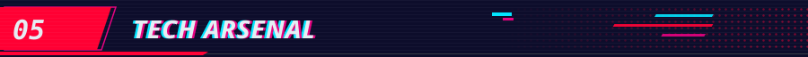</h2>

<table>
<tr>
<td width="1000" valign="top">
<br>
      
</td>
</tr>
<tr>
<td width="1000" valign="top">
<br>
     
</td>
</tr>
<tr>
<td width="1000" valign="top">
<br>
     
</td>
</tr>
<tr>
<td width="1000" valign="top">
<br>
         
</td>
</tr>
<tr>
<td width="1000" valign="top">
<br>
          
</td>
</tr>
<tr>
<td width="1000" valign="top">
<br>
       
</td>
</tr>
</table>

<h2>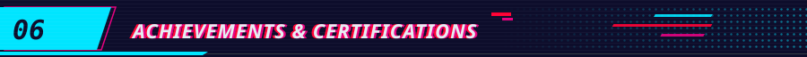</h2>


<table>
<tr>
<td width="1000" valign="top">
&nbsp; <b>1st Place, Vashisht Hackathon 3.0</b> · EITDM Kancheepuram, XRED FinTech track · project: KRED
</td>
</tr>
<tr>
<td width="1000" valign="top">
&nbsp; <b>1st Place, HackHub '25</b> · IEEE &amp; GitHub, autism screening (AutCore)
</td>
</tr>
<tr>
<td width="1000" valign="top">
&nbsp; <b>1st Place, IIT Ropar × AnnamAI Hackathon</b> · AI-driven research systems
</td>
</tr>
<tr>
<td width="1000" valign="top">
&nbsp; <b>Special Recognition, Pitchathon '24</b>
</td>
</tr>
</table>


<table>
<tr>
<td width="1000" valign="top">
&nbsp; <b>Published patent: CropCore</b> · Indian Patent Office · Patent No. <code>202541067987</code>
</td>
</tr>
<tr>
<td width="1000" valign="top">
&nbsp; <b>Three patents</b> · DiscApAI, PACDI, DiagInc
</td>
</tr>
<tr>
<td width="1000" valign="top">
&nbsp; <b>Two papers</b> · SSL-RUL; Synthetic Taphonomic Deformation
</td>
</tr>
<tr>
<td width="1000" valign="top">
&nbsp; <b>Best Technical Club Award</b> · VIT Chennai
</td>
</tr>
</table>


<table>
<tr><td width="150" valign="top"><code>Stanford</code></td><td width="850" valign="top">Supervised Machine Learning: Regression &amp; Classification</td></tr>
<tr><td width="150" valign="top"><code>Stanford</code></td><td width="850" valign="top">Advanced Machine Learning Algorithms</td></tr>
<tr><td width="150" valign="top"><code>IBM</code></td><td width="850" valign="top">Machine Learning with Python</td></tr>
<tr><td width="150" valign="top"><code>Google</code></td><td width="850" valign="top">Introduction to Generative AI</td></tr>
<tr><td width="150" valign="top"><code>AWS</code></td><td width="850" valign="top">AWS ML Foundations</td></tr>
<tr><td width="150" valign="top"><code>NASBA</code></td><td width="850" valign="top">Intro to AI</td></tr>
<tr><td width="150" valign="top"><code>NASBA</code></td><td width="850" valign="top">AI Foundations: Neural Networks</td></tr>
<tr><td width="150" valign="top"><code>Google Cloud</code></td><td width="850" valign="top">Data Transformation with Google Cloud</td></tr>
</table>

<h2>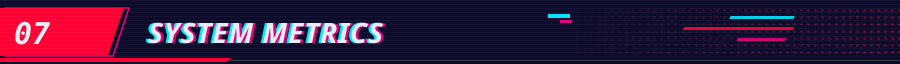</h2>


<!-- STATS:START -->
<table>
<tr><th align="left" width="250">Contributions</th><th align="left" width="250">Current streak</th><th align="left" width="250">Longest streak</th><th align="left" width="250">Public repos</th></tr>
<tr><td width="250">2,397</td><td width="250">11 days</td><td width="250">11 days</td><td width="250">21</td></tr>
</table>

<sub>Last 12 months, synced 2026-11-09. Live graph: [github.com/prnvvv](https://github.com/prnvvv).</sub>
<!-- STATS:END -->

<h2>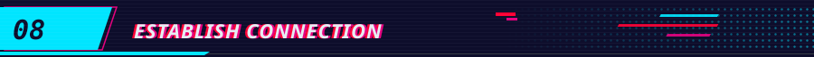</h2>

<p><a href="https://github.com/prnvvv"></a> <a href="https://linkedin.com/in/prannavakhanth"></a> <a href="https://leetcode.com/u/peter-parker"></a> <a href="https://prnvvv-portfolio-website.vercel.app"></a> <a href="mailto:prannavakhanth12@gmail.com"></a></p>

<table>
<tr><td width="170" valign="top"><code>EMAIL</code></td><td width="830" valign="top"><a href="mailto:prannavakhanth12@gmail.com">prannavakhanth12@gmail.com</a></td></tr>
<tr><td valign="top"><code>LOCATION</code></td><td width="830" valign="top">Chennai, Tamil Nadu, India</td></tr>
</table>


```text
prnvvv@portfolio:~$ exit
logout
```
